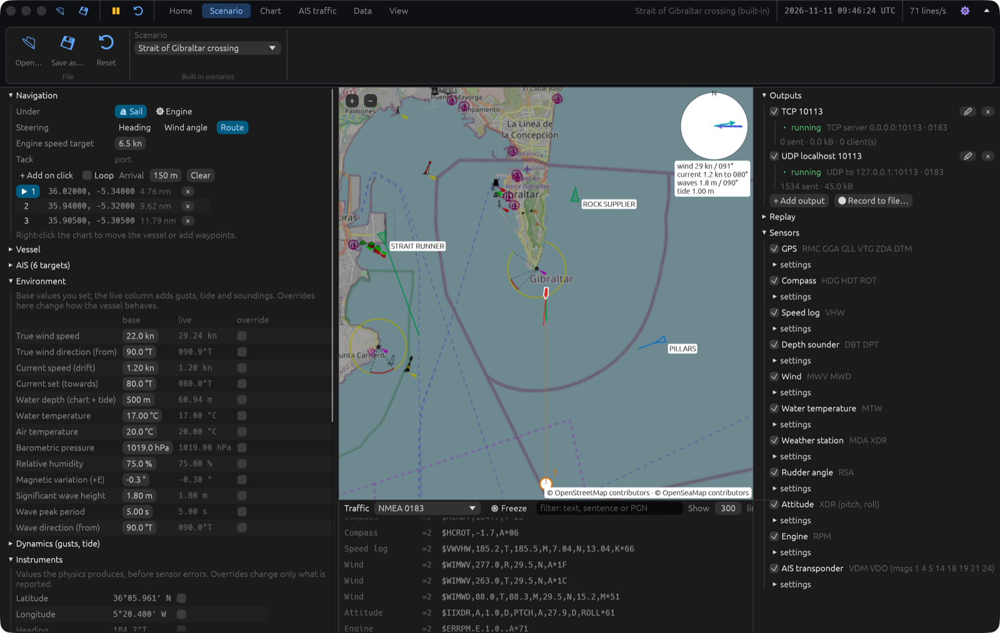

# Marine Data Simulator




## About

A desktop simulator of marine instrument data, written in Rust with [egui](https://github.com/emilk/egui).
A vessel sails or motors through a simulated environment (wind, current, tide, waves, depth,
weather). Its instruments send **NMEA 0183**, **NMEA 2000** (in the text formats gateways use),
**Signal K** and **AIS** to any program that listens: chart plotters such as OpenCPN, Signal K
servers, instrument displays, data hubs, or software you are testing.

- **Realistic physics:** polars, heel, leeway, waves, gusts, tide, an autopilot that tacks.
- **Sensor errors:** noise, bias, calibration, latency, resolution and compass deviation.
- **Override any value:** replace it, offset it or freeze it, either in the environment
  (which changes how the boat behaves) or in the instruments (which changes only what is reported).
- **AIS traffic:** Class A and B vessels, base stations, aids to navigation and SARTs, with CPA/TCPA.
- **Every common transport:** UDP, TCP server and client, WebSocket, serial port and file.
- **Record and replay** NMEA logs, including logs from real boats.
- **Headless CLI** for scripts and CI.
- **AI agents** can watch and drive it through the Model Context Protocol (MCP).
- **Six built-in scenarios**, from Cape Canaveral to the Strait of Gibraltar, and your own as TOML files.
- **In English, French and German.**

Runs on macOS, Windows and Linux.

📖 **[User manual](docs/USER_MANUAL.md)**: a guide to the app, the CLI and the scenario files.

⚠️ **For testing only:** never connect it to a vessel under way or feed it into public AIS
services. See [Safety and responsible use](#safety-and-responsible-use).

## Download

Latest release, **[v0.1.1](https://github.com/olafont/MarineDataSimulator/releases/latest)**:

- **macOS** (Apple Silicon and Intel): [MarineDataSimulator-0.1.1-macos-universal.dmg](https://github.com/olafont/MarineDataSimulator/releases/download/v0.1.1/MarineDataSimulator-0.1.1-macos-universal.dmg)
- **Windows** (x86-64): [marine-data-simulator-0.1.1-windows-x86_64.zip](https://github.com/olafont/MarineDataSimulator/releases/download/v0.1.1/marine-data-simulator-0.1.1-windows-x86_64.zip)
- **Linux** (x86-64): [marine-data-simulator-0.1.1-linux-x86_64.tar.gz](https://github.com/olafont/MarineDataSimulator/releases/download/v0.1.1/marine-data-simulator-0.1.1-linux-x86_64.tar.gz)

The builds are not signed, so the system warns on first launch: on macOS see
[the manual](docs/USER_MANUAL.md#install), on Windows choose **More info → Run anyway**.
To build from source, see [Quick start](#quick-start).

## Quick start


On start, the simulator serves data on **TCP port 10113** (all interfaces) and sends it by
**UDP to 127.0.0.1:10113**. In OpenCPN, add a network connection with protocol TCP, address
`localhost` and port `10113`. The boat and the AIS traffic appear on the chart.

> Port 10113 is used instead of the usual NMEA port 10110, so the simulator does not clash
> with other NMEA software on the same machine. You can change it in the Outputs panel.

**macOS app:** `scripts/build-macos-app.sh` builds `Marine Data Simulator.app` and a DMG in
`target/macos/` (add `--universal` for Apple Silicon and Intel). See
[the manual](docs/USER_MANUAL.md#install) for the first launch on another Mac.

**Linux:** first install the GUI libraries, e.g. on Debian/Ubuntu:

```sh
sudo apt-get install libxkbcommon-dev libgl1-mesa-dev libwayland-dev libx11-dev \
  libxcursor-dev libxrandr-dev libxi-dev libgtk-3-dev
```

**Windows:** if the build fails in `aws-lc-sys`, install [NASM](https://www.nasm.us) and
add it to `PATH`.

## Command line

```sh
cargo run --release -p app -- my.toml                    # app with a scenario file
cargo run --release -p cli -- --print                    # headless, echo sentences to stdout
cargo run --release -p cli -- --list                     # built-in scenarios
cargo run --release -p cli -- --builtin marseille-sailing.toml --time-scale 10
cargo run --release -p cli -- --record run.nmea          # also record everything to a file
cargo run --release -p cli -- --replay run.nmea --replay-speed 10 --exit-after-replay
cargo run --release -p cli -- --write-default-scenario my.toml
cargo run --release -p cli -- --mcp-port 10115           # headless, AI agents connect over MCP
```

See [the manual](docs/USER_MANUAL.md#11-command-line-cli) for all options.

## AI agents (MCP)

An AI agent such as Claude can drive the simulator through the
[Model Context Protocol](https://modelcontextprotocol.io): read the state, steer, change the
wind or the depth, override an instrument, add AIS traffic (including a ship on a collision
course), load scenarios and read the data being sent, in any of its formats.

```sh
# The app: tick Preferences › AI agents › Let agents connect, then
claude mcp add --transport http marine-sim http://127.0.0.1:10115/mcp

# Headless: the agent starts the simulator itself
claude mcp add marine-sim -- /path/to/marine-sim-cli --mcp-stdio
```

The server is off until you switch it on, listens on this computer only, and never reads or
writes files. See [the manual](docs/USER_MANUAL.md#14-ai-agents-mcp) for the tools and limits.

## What it produces

| Sensor | NMEA 0183 | NMEA 2000 PGNs | Signal K |
|---|---|---|---|
| GPS | RMC GGA GLL VTG ZDA DTM | 129025 129026 129029 126992 127258 | `navigation.position`, `courseOverGroundTrue`, `speedOverGround`, `datetime`, `gnss.*` |
| Compass | HDG HDT ROT | 127250 127251 | `navigation.headingTrue`, `headingMagnetic`, `headingCompass`, `rateOfTurn` |
| Speed log | VHW | 128259 | `navigation.speedThroughWater` |
| Depth sounder | DBT DPT | 128267 | `environment.depth.*` |
| Wind | MWV (relative and true) MWD | 130306 | `environment.wind.*` |
| Water temperature | MTW | 130312 | `environment.water.temperature` |
| Weather station | MDA XDR | 130312 130313 130314 130306 | `environment.outside.*` |
| Rudder | RSA | 127245 | `steering.rudderAngle` |
| Attitude | XDR (pitch, roll) | 127257 127252 (heave) | `navigation.attitude`, `environment.heave` |
| Engine | RPM | 127488 | `propulsion.main.revolutions` |
| AIS transponder | VDM, VDO: messages 1/2, 4, 5, 14, 18, 19, 21, 24A/B | 129038 129039 129040 129041 129793 129794 129802 129809 129810 | other vessels, `atons.`, `shore.basestations.` |

On NMEA 2000, each simulated device has its own source address and announces itself (address
claim 60928, product information 126996). Signal K uses SI units.

| Data format | Line format |
|---|---|
| NMEA 0183 | `$GPRMC,…` / `!AIVDM,…` |
| NMEA 2000, Yacht Devices RAW | `14:30:15.250 R 09F8010A 3F 9F DC FF FF FF FF FF` (one CAN frame per line, fast packets split) |
| NMEA 2000, Actisense N2K ASCII | `A143015.250 0AFF2 1F801 3F9FDCFFFFFFFFFF` |
| NMEA 2000, canboat plain | `2026-06-21T14:30:15.250Z,2,129025,10,255,8,3f,9f,…` |
| Signal K | delta JSON, one per line; a Signal K WebSocket output also sends the hello and serves `GET /signalk` |

| Output | Notes |
|---|---|
| UDP | unicast or broadcast, one line per datagram |
| TCP server | every connected client gets every line |
| TCP client | connects to a server (e.g. a hub) and reconnects every 2 s |
| WebSocket server | one text frame per line |
| Serial port | any baud rate; reopens an unplugged USB adapter |
| File | optional NMEA 4 TAG-block timestamps, ready for replay |

Each output carries one data format and can be limited to some sentence types, PGNs or Signal K
sensors (e.g. `RMC, GGA`, `129025, 130306` or `gps, wind`).

## Built-in scenarios

| File | Description |
|---|---|
| [`gibraltar-strait-sailing.toml`](scenarios/gibraltar-strait-sailing.toml) (default) | A yacht crosses the Strait of Gibraltar to Ceuta in a strong levanter, through both traffic lanes, while the Atlantic inflow sets it east. |
| [`cape-canaveral-sailing.toml`](scenarios/cape-canaveral-sailing.toml) | A 12 m yacht sails a loop off Cocoa Beach in an east-southeasterly breeze, with one upwind leg and 7 AIS stations. |
| [`marseille-sailing.toml`](scenarios/marseille-sailing.toml) | A yacht sails with gusts, waves and soundings. One leg is upwind, so the boat tacks. |
| [`channel-crossing-motor.toml`](scenarios/channel-crossing-motor.toml) | A motor vessel in a 5 m tide with 2.5 kn tidal streams and ferry traffic. |
| [`singapore-strait-motor.toml`](scenarios/singapore-strait-motor.toml) | A motor launch loops off Singapore's East Coast in the northeast monsoon, beside the anchorages and the Strait's traffic lanes. |
| [`long-beach-sailing.toml`](scenarios/long-beach-sailing.toml) | A yacht sails outside the Long Beach breakwater in a westerly sea breeze and a long swell. One leg is upwind, with ships at anchor and a pilot boat. |

Depths and traffic are illustrative. **Do not use them for navigation.**

## Development

```
crates/
  sim-core     physics, environment, AIS stations, overridable values (no I/O)
  sim-sensors  sensor rates, errors and noise → typed measurements; AIS scheduling
  protocols    NMEA 0183, AIS, NMEA 2000 and Signal K encoders
  transports   UDP, TCP, WebSocket, serial and file outputs with sentence filters
  scenario     TOML scenario files
  engine       10 Hz simulation thread, snapshots, traffic monitor, replay
  mcp          Model Context Protocol server: tools for AI agents (HTTP and stdio)
  app          egui desktop app (walkers map: OpenStreetMap + OpenSeaMap)
  cli          headless runner
```

```sh
cargo test --workspace                                   # unit, golden, round-trip and loopback tests
cargo clippy --workspace --all-targets -- -D warnings
```

NMEA 0183 output is checked against the independent `nmea` crate, AIS output against the
`ais` crate and a reference sentence, and NMEA 2000 field layouts against the canboat PGN
database. The tests also check that every built-in scenario loads and saves unchanged, and
that a recording replays line for line.

[ROADMAP.md](ROADMAP.md) lists milestones and ideas (fault injection, radar).

Map tiles: © OpenStreetMap contributors, © OpenSeaMap contributors. Tiles are cached in the
OS cache directory.

## Safety and responsible use

Marine Data Simulator produces **simulated** data for testing. It is not for navigation.

- **Never connect it to the instruments or network of a vessel that is under way, or to a
  system someone relies on for navigation.** Simulated positions, depths and AIS targets look
  real on a chart plotter, and could cause an accident.
- **Do not send its AIS output to public AIS services** (MarineTraffic, AISHub, VesselFinder
  and the like) or to a VHF transmitter. Feeding fictitious vessels into real AIS traffic is
  spoofing: it breaks those services' terms and, in many countries, the law. The simulator
  itself never transmits on radio.
- **Fictitious identities.** The built-in scenarios, and the targets you add in the app, use
  MMSIs that cannot belong to a real station: where a real MMSI has a country code (201 to
  775), they have 100. Ship names, call signs and IMO numbers are made up (the IMO numbers fail
  their check digit). If you write your own scenarios, do not use the MMSI or name of a real
  vessel.
- **On a shared network**, outputs on `0.0.0.0` or to a broadcast address reach every computer
  on it, including any navigation equipment connected to it. Prefer `127.0.0.1` or a network
  set aside for testing.

The software comes with no warranty (GPL-3.0, sections 15 and 16; see [LICENSE](LICENSE)).

## License

Copyright © 2026 Olivier Lafont.

This program is free software: you can redistribute it and/or modify it under the terms of the
GNU General Public License version 3, as published by the Free Software Foundation. It is
distributed in the hope that it will be useful, but WITHOUT ANY WARRANTY; without even the
implied warranty of MERCHANTABILITY or FITNESS FOR A PARTICULAR PURPOSE. See [LICENSE](LICENSE).

Anyone who distributes it, changed or not, must do so under the same license and with its
source code. Third-party code and data are listed in
[THIRD_PARTY_NOTICES.md](THIRD_PARTY_NOTICES.md).
